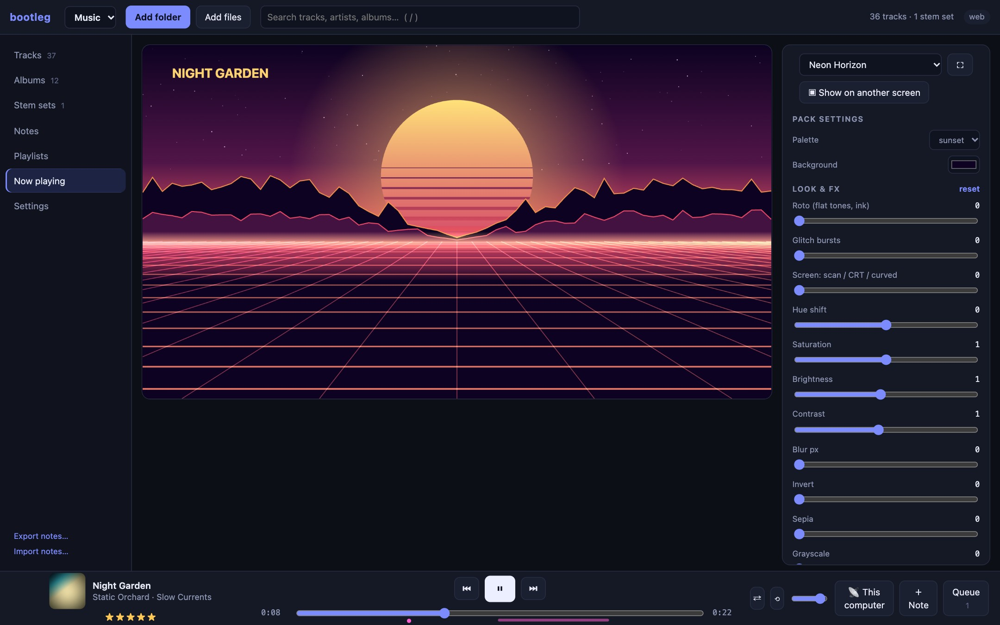
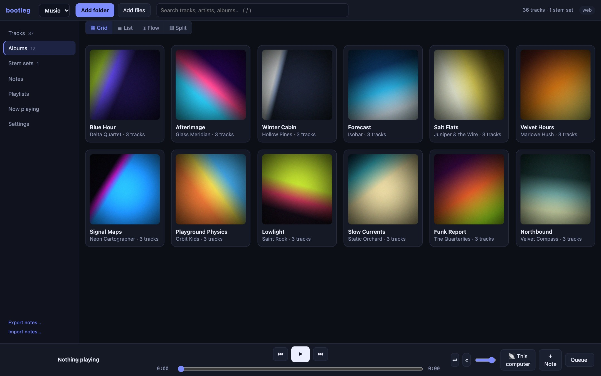
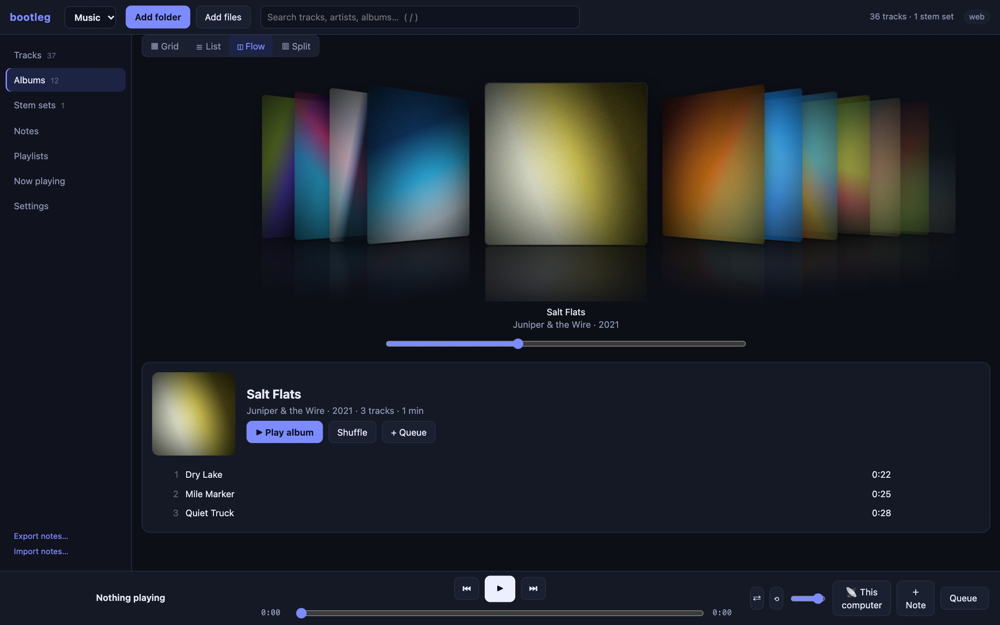
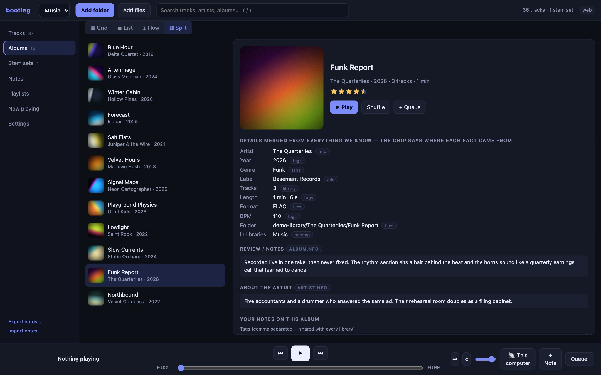
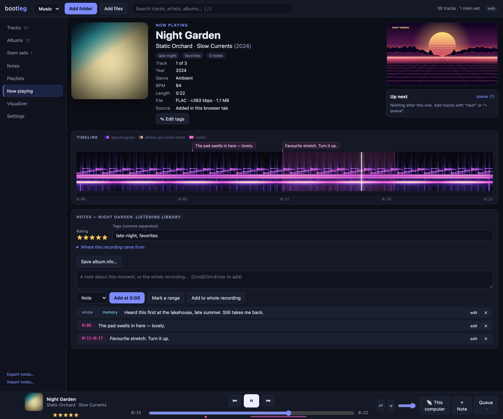
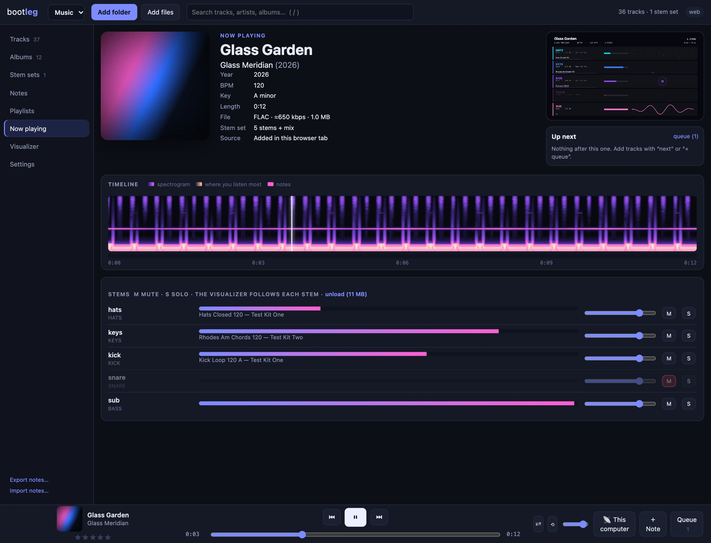
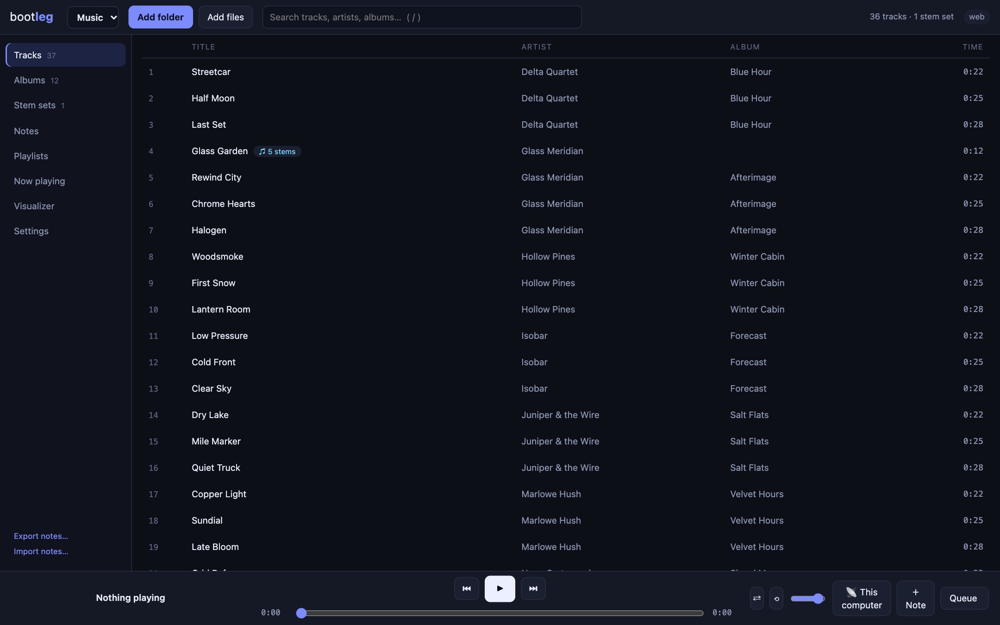
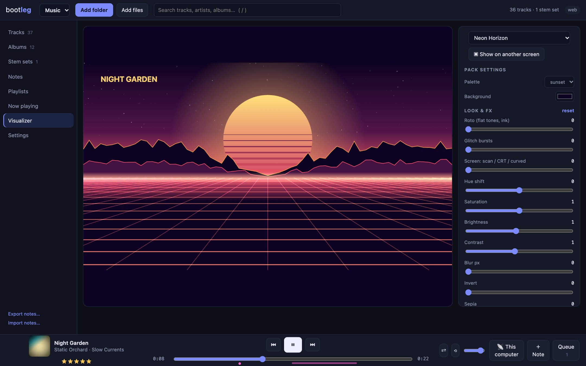

# bootleg

A music player for **large libraries**, with live visualizers, stem mixing, notes and ratings, casting and server support. A web app that also runs as a desktop app (macOS, Linux) through Tauri. MIT licensed.

- **Plays** mp3, flac, m4a, ogg, opus, wav with their tags and cover art, and **stem sets** (the [bootleg stem format](docs/STEM-FORMAT.md)) — a folder of stems plus its mix, shown as one item, played from the mix instantly, with a live stem mixer (mute, solo, trim) on demand.
- **Big libraries stay fast:** virtualized lists, a persistent incremental library cache, native (Rust) scanning and tag reading — 30,000 files scan in under a second and read their tags in a couple of seconds.
- **Libraries** with a *Listening* or *Studio* mode; notes, ratings, tags, provenance and status that follow the recording; album views (grid, list, cover flow, split with merged details); `.nfo` files as a metadata source; playlists (M3U) and notes import/export.
- **Mini player**: a small window with the controls, styled like the Car Thing app — it comes up when you minimize bootleg.
- **Now playing** puts the track first: everything known about it, a timeline with the song's spectrogram, your notes as callouts and a heatmap of where you listen most, and what plays next.
- **Live visualizers** from [bootleg-vizualizer](https://github.com/chrisskurda/bootleg-vizualizer), including per-stem visuals: a tile on Now playing (settings slide in), their own page with every setting out in the open, a mini player while you browse, fullscreen, or on another display.
- **Sources and outputs are plugins:** Subsonic/OpenSubsonic servers (Navidrome, Airsonic, Gonic) today; DLNA/UPnP casting with album art. Optional **extensions** (a Car Thing remote, a 10-band equalizer) sit behind a small API, can add their own page to the left pane, and are off by default.

## Screenshots

<p align="center"></p>

<table>
<tr>
<td width="50%"><br><sub><b>Albums</b> — grid, list, cover flow and split views</sub></td>
<td width="50%"><br><sub><b>Cover flow</b> — a 3D carousel, with the album's tracks below</sub></td>
</tr>
<tr>
<td width="50%"><br><sub><b>Split view</b> — details merged from tags, <code>.nfo</code> files and the folder, each with its source; album notes and rating</sub></td>
<td width="50%"><br><sub><b>Notes</b> — ratings, tags, notes on a moment or a range (callouts on the timeline, markers on the seek bar), where the recording came from</sub></td>
</tr>
<tr>
<td width="50%"><br><sub><b>Stem sets</b> — mute, solo and trim stems; the visualizer follows each one</sub></td>
<td width="50%"><br><sub><b>Tracks</b> — fast on big libraries; a stem set is one item with a ♫ badge</sub></td>
</tr>
<tr>
<td width="50%"><br><sub><b>Visualizer</b> — its own page, every pack and look setting out in the open</sub></td>
<td width="50%"></td>
</tr>
</table>

<sub>The screenshots use a synthetic demo library (fictional artists, generated art and audio): `npm run demo-library && npm run screenshots`.</sub>

## Run it
```
npm install
npm run dev            # build + serve the web app at http://localhost:8800
npm test               # unit + browser end-to-end tests (needs Chrome and ffmpeg)
npx tauri build        # the desktop app (needs Rust; see src-tauri/)
```
`scripts/selftest.sh <built app>` and `scripts/linux/test.sh` run a headless self-test of the desktop app; `npm run perf` checks the performance budget.

## Editing tags

Edit a track's tags, or a whole album's, with the **edit** / **✎ Edit album** buttons. Edits are kept in bootleg's own database (with your notes; they are included in the notes export) and shown instead of what the file or server says. The files and the server are not touched.

**Writing edits into the files** is a separate feature, **off by default** (desktop app: *Settings → Tag edits → files*). You review every edit (old → new, and the file it goes to) before anything is written. Write them right away, or approve them for a schedule that runs every N hours when the folders are reachable. Each file gets a copy with the new tags, which then replaces it in one rename, so a failure never leaves a half-written file. Notes, ratings and playlists stay attached to a rewritten file.

For a **server's** music, choose the folder its music is shared from on this computer (for example an SMB share; it only needs to be mounted when writing). bootleg finds each track's file from the path the server reports, works out whether the share sits above or at the server's own music folder, and checks every match by exact file size. When a server reports no usable path, files are matched by exact size and type; if two files have the same size, the track is left alone and listed. After writing, bootleg asks the server to rescan, and drops its own edit once the server reports the new tags.

| Server | What to set so bootleg can find the files |
|---|---|
| **Navidrome** | Off by default: *Settings → Players → bootleg → Report Real Path* (the "bootleg" player appears after bootleg first connects). Or set `ND_SUBSONIC_DEFAULTREPORTREALPATH=true` before bootleg first connects. |
| Airsonic / Airsonic-Advanced, Gonic | These report paths inside their music folder without a setting, as far as we know. *Settings → Tag edits → files → Check* shows how many sample tracks were found either way. |
| Any other Subsonic server | Same check; without paths, the exact-size match is used. |

## Documentation
- [docs/STEM-FORMAT.md](docs/STEM-FORMAT.md) — the bootleg stem format
- [docs/SOURCE-PLUGINS.md](docs/SOURCE-PLUGINS.md) — library sources (Subsonic is the reference) and cast outputs
- [docs/EXTENSIONS.md](docs/EXTENSIONS.md) — optional add-ons and their API
- [docs/PLAN.md](docs/PLAN.md) — design notes and status
- [CHANGELOG.md](CHANGELOG.md) · [CONTRIBUTING.md](CONTRIBUTING.md)

## Vendored
`vendor/bootleg-vizualizer/` is a pinned `git subtree` of the visualizer (spec, runtime, FX, packs, analysis). Don't edit it here — change it in bootleg-vizualizer and pull: `git subtree pull --prefix vendor/bootleg-vizualizer https://github.com/chrisskurda/bootleg-vizualizer.git <tag> --squash`.

## Related
- [bootleg-vizualizer](https://github.com/chrisskurda/bootleg-vizualizer) — the pack format, runtime and packs
- [bootleg-bridge-thing](https://github.com/chrisskurda/bootleg-bridge-thing) — a Spotify Car Thing remote: controls bootleg and shows its visualizers (connects through the optional Car Thing bridge extension)
